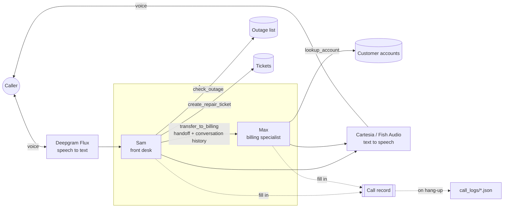

# Northwind Fiber: Voice Support Agent

A voice customer-support line for **Northwind Fiber**, a fictional home internet provider. Callers talk to it like a real support line: it troubleshoots internet problems, opens repair tickets, transfers billing questions to a specialist agent, and saves a structured summary of every call.

Built with [LiveKit Agents](https://docs.livekit.io/agents/) (Python), using Deepgram for speech recognition, Cartesia for speech, and Gemma 4 as the language model.

> 🎥 **Demo video:** coming soon

---

## What it does

- **Front desk agent ("Sam")**: greets the caller and handles internet problems:
  - checks for a **known outage** in the caller's ZIP code
  - walks them through a **router restart**, one step at a time
  - opens a **repair ticket** if that doesn't fix it
- **Billing specialist ("Max")**: Sam **hands the call off** to Max for billing questions. Max has his own voice and instructions, already knows what the caller told Sam, verifies the account by phone number, and explains the balance.
- **Call summaries**: when a call ends, a structured JSON record (reason, ZIP code, outage result, ticket number, actions taken, full transcript) is saved to `call_logs/`. This is the kind of output a business could feed into a CRM or ticketing system.
- **Guardrails**: declines off-topic or inappropriate requests and does not invent facts it doesn't have.

## Architecture



Each turn: the caller's speech is transcribed, the active agent's LLM decides whether to reply or call a tool, and the reply is spoken back. A turn detector decides when the caller has finished speaking.

| Layer | Choice |
|---|---|
| Framework | LiveKit Agents (Python), LiveKit Cloud |
| Speech to text | Deepgram Flux (via LiveKit Inference) |
| LLM | Gemma 4 31B (via LiveKit Inference) |
| Text to speech | Cartesia Sonic 3 (Sam), Fish Audio S2.1 Pro (Max) |
| Testing | pytest + LiveKit's agent testing framework, with an LLM judge |

## How it works

All of the agent code is in [`src/agent.py`](src/agent.py).

- **Agents are classes.** `FrontDeskAgent` (Sam) and `BillingAgent` (Max) each define instructions, a model, an optional voice, and tools.
- **Tools are Python functions** marked with `@function_tool`. The docstring tells the LLM *when* to use the tool, and the code does the work. The "databases" are small in-memory dictionaries standing in for real systems.
- **A handoff is a tool that returns another agent.** `transfer_to_billing` returns a `BillingAgent` and passes it the conversation history (without Sam's instructions), so Max doesn't ask the caller to repeat themselves.
- **Shared call state.** Each call gets a `CallRecord` (session `userdata`). Tools write facts into it as they run, so the summary comes from what the code actually did rather than what the model remembers. A shutdown callback writes it to disk when the call ends.
- **Prompts for behavior, code for hard rules.** Conversational behavior lives in the instructions. Rules that must never break, like "a ZIP code is exactly five digits", are enforced inside the tool.

## Testing

Seven turn-level tests in [`tests/test_agent.py`](tests/test_agent.py) run text-only conversations against the real model and check both **structure** (was the right tool called? did the handoff happen? was bad data kept out of the call record?) and **meaning** (an LLM judge checks that the reply matches the intended outcome).

| Test | Checks that… |
|---|---|
| `internet_problem_asks_for_zip_not_account` | Sam asks for a ZIP code, not an account |
| `outage_zip_reports_outage` | an outage ZIP triggers the outage check and is reported |
| `already_restarted_creates_ticket` | a ticket is *actually created*, not just announced |
| `incomplete_zip_is_not_used` | a misheard four-digit ZIP is rejected and never saved |
| `outage_system_down_is_handled_gracefully` | if the outage system errors (mocked), Sam admits it and keeps helping |
| `billing_question_transfers_to_max` | billing questions hand off to Max |
| `max_does_not_invent_charge_details` | Max doesn't make up what a charge is for |

```bash
uv run pytest
```

[`scenarios.yaml`](scenarios.yaml) also defines full-conversation simulations (a simulated caller graded against expectations) that can be run with `lk agent simulate text --scenarios scenarios.yaml`.

## Problems I found and fixed

Most of the work on this project was testing it like a difficult caller, reading transcripts, and fixing what went wrong:

1. **Rules leaked between tasks.** "Verify the account before discussing it" was meant for billing, but Sam applied it to everything and refused to troubleshoot without an account. *Fix:* split the instructions into separate sections for billing and internet problems, and state explicitly that internet help needs no account.
2. **The agent announced actions without doing them.** Sam said "I'll create a ticket for you" and then never called the tool. Later, a test caught the same bug with transfers. *Fix:* explicit instructions to act instead of announcing, plus tests that assert the tool call actually happened.
3. **Hallucinated details.** The billing agent confidently said a balance was the "monthly service charge", which isn't in the data. *Fix:* only state facts from the account lookup and offer a follow-up otherwise, locked in with a test.
4. **Bad data saved silently.** The call summary revealed that a misheard four-digit ZIP code ("1 0 0 0") had been padded to `10000`, checked, and saved ([see the raw record](docs/sample_call_summary.json)). *Fix:* validation inside the tool, which the model cannot bypass.
5. **One fix changed behavior elsewhere.** After adding ZIP validation, the test suite showed that when the outage system was down, Sam now asked for the ZIP code again instead of moving on. *Fix:* instructions for the system-error case. This is the reason to rerun all tests after every change.

## Running it yourself

**Requirements:** Python 3.10+, [uv](https://docs.astral.sh/uv/), the [LiveKit CLI](https://github.com/livekit/livekit-cli), and a free [LiveKit Cloud](https://cloud.livekit.io/) account. All models run through LiveKit Inference, so no other API keys are needed.

```bash
cp .env.example .env.local            # then fill in your LiveKit URL, API key, and secret
                                       # (from your project's settings in LiveKit Cloud)
uv sync                                # install dependencies
uv run python src/agent.py download-files
lk agent dev                           # start the agent, then talk to it in the Agent Console
```

Try saying: *"My internet isn't working"* (ZIP **94107** has a simulated outage; any other five-digit ZIP doesn't), or *"I have a question about my bill"* (test phone number **555-123-4567**).

## Project structure

```
src/agent.py               # agents, tools, call record, and session setup
tests/test_agent.py        # turn-level tests
scenarios.yaml             # full-conversation simulations
docs/sample_call_summary.json
```

## What I'd add next

- A real phone number through LiveKit telephony (SIP)
- An "escalate to a human" path
- Real data sources (a database for accounts, an API for tickets) behind the same tools
- Deployment to LiveKit Cloud so it runs without a laptop

## Credits

Built on LiveKit's [agent-starter-python](https://github.com/livekit-examples/agent-starter-python) template. Developed as a learning project with help from Claude as a coding assistant.
